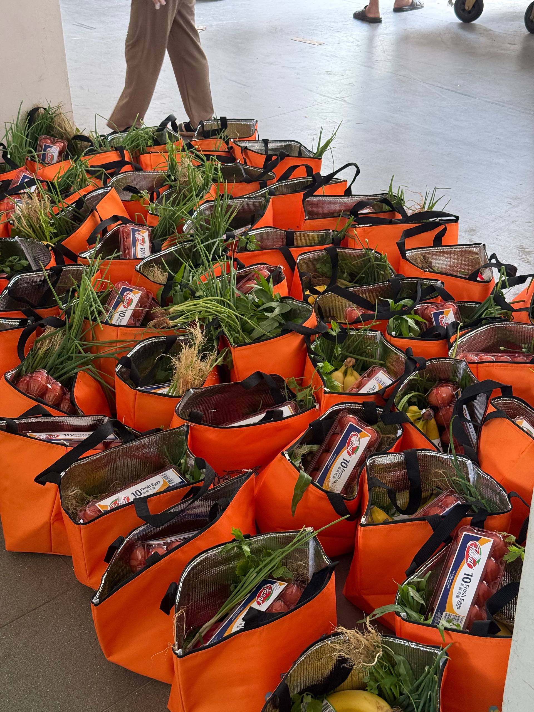

# Food for All Database 🏡

Welcome! This is the GitHub repository responsible for running the codes behind the Food Distribution Database, a real-time tracker for food aid efforts conducted at the Pearl Garden neighbourhood in Bedok.

[](https://foodforall11.streamlit.app/)

<div align="center">

</div>

## Key Features 🚀 
1. Log a distribution - via a Google Form on the home page
2. View summarised distribution records - via the map on the home page
3. View full records of individual blocks - via the block records page
4. Remove a distribution - via the block records page

## How it Works - a brief summary 📦
1. Food distribution records are recorded via a Google Form which is then transferred to a Google Sheet.
2. Python files (on this repository) reads the records from the Google Sheet and stores it into an object database.
3. Data from the object database is displayed on the website in the form of a map of the Pearl Garden neighbourhood, as well as tables of individual blocks and their records.

## Project Directory 📖
```text
food4all11/
├── .devcontainer/
│   ├── devcontainer.json
├── .streamlit/
│   ├── config.toml
├── images/
│   ├── bags.jpeg
│   ├── class_diagram.jpeg
│   ├── dist_bags.jpeg
├── pages/
│   ├── block_records.py
│   ├── home.py
├── .gitignore
├── README.md
├── app.py
├── google_sheets.py
├── map.py
├── models.py
├── requirements.txt
└── sync_updated.py
```

## Functions of each Files 📜
### models.py
Contains the Distribution, Block, and Neighbourhood classes, the building blocks of the database.
<div align="center">

</div>
### google_sheets.py
### map.py
### sync_updated.py
### app.py
### home.py
### block_records.py
