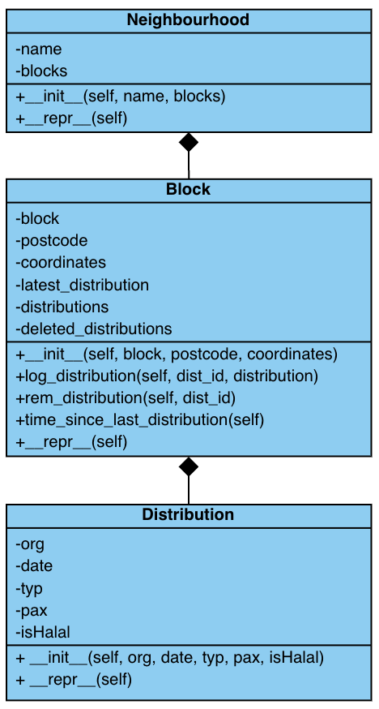

# Food for All Database

Welcome! This is the GitHub repository responsible for running the codes behind the Food Distribution Database, a real-time tracker for food aid efforts conducted at the Pearl Garden neighbourhood in Bedok.

[](https://foodforall11.streamlit.app/)

<div align="center">

</div>

## Key Features 🚀 
1. Log a distribution - via a Google Form on the home page
2. View summarised distribution records - via the map on the home page
3. View full records of individual blocks - via the block records page
4. Remove a distribution - via the block records page

## How it Works - a brief summary 📦
1. Food distribution records are recorded via a Google Form which is then transferred to a Google Sheet.
2. Python files (on this repository) reads the records from the Google Sheet and stores it into an object database.
3. Data from the object database is displayed on the website in the form of a map of the Pearl Garden neighbourhood, as well as tables of individual blocks and their records.

## Project Directory 📖
```text
food4all11/
├── .devcontainer/
│   ├── devcontainer.json
├── .streamlit/
│   ├── config.toml
├── images/
│   ├── bags.jpeg
│   ├── class_diagram.jpeg
│   ├── dist_bags.jpeg
├── pages/
│   ├── block_records.py
│   ├── home.py
├── .gitignore
├── README.md
├── app.py
├── google_sheets.py
├── map.py
├── models.py
├── requirements.txt
└── sync_updated.py
```

## Functions of each Files 📜
### models.py
Contains the Distribution, Block, and Neighbourhood classes, the building blocks of the database. The class hierarchy is as follows.
<div align="center">

</div>

### google_sheets.py
Contains all functions related to fetching/writing Google Sheet data.
| Function | Description |
| :--- | :--- |
| `get_gspread_client` | Establishes connection between Google Sheets and the Streamlit web app. |
| `fetch_sheet_records` | Fetches Google Sheet records in order to build the database. |
| `add_deletion_records` | Writes deleted distribution IDs (from the web app's Distribution Removal feature) into a separate sheet. |

### map.py
Contains functions related to constructing the interactive map of the Pearl Garden neighbourhood.
| Function | Description |
| :--- | :--- |
| `time_to_colour` | Maps the time since last distribution (of every block) to their representative colours.  |
| `create_pg_map` | Creates the map object. |

### sync_updated.py
Contains data_to_db, which processes the raw Google Sheet data into the object database. 

### app.py
Main page for Streamlit to run the app.

### home.py
Home page of the database, containing the following.
1. Introduction to the website
2. Shows summarised map of block records (last distribution, days since last distribution, total distributions)
3. Link to Google Form to log distributions

### block_records.py
Page for individual block records, containing the following.
1. Table of full distribution records for each block
2. Removal button for users to delete distributions

## Installation 🔧

## Usage 🏡

## Authors 👥 
* Caleb F. ([@ccalebbf](https://github.com/ccalebbf)) <br>
Special thanks to my group mates, Darren T., Chloe T., Keira L., Sigmund K., and Zeke N. for their help as well!
